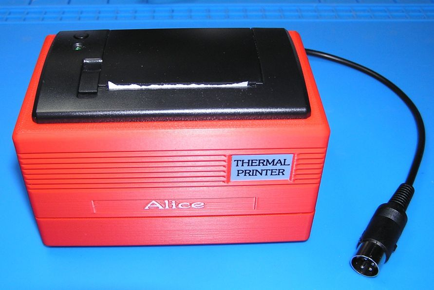
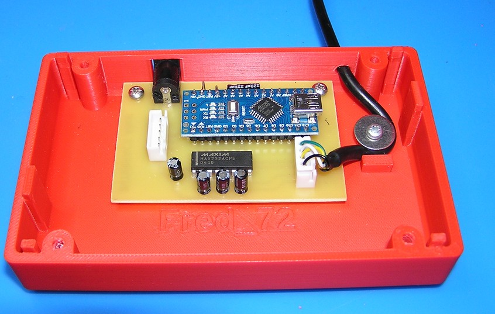
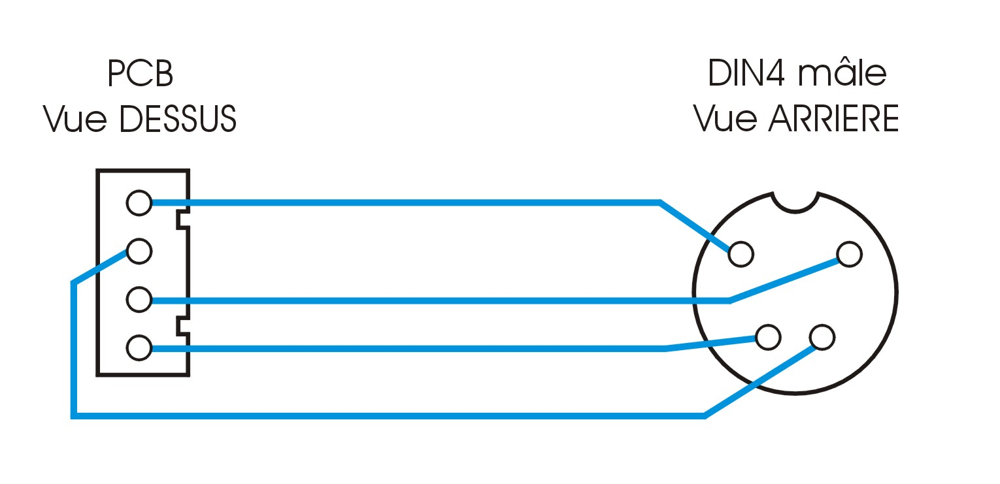

# Mini imprimante pour Alice/MC10 #

Ce montage utilise une petite imprimante thermique utilisant du papier genre ticket de caisse (58mm de large).
Le modèle utilisé est le GR701 TTL. D'autres modèles sont utilisables mais il faut modifier le boîtier.

Une liaison directe Alice-Imprimante n'est pas possible et la conversion est assurée par un arduino nano.

- Permière problème: l'imprimante utilise une liaison série TTL à 9600 Bauds avec 1 bit de stop sans parité tandis que l'Alice utilise une liaison série à 600 Bauds avec 2 bits de stop sans parité.
- Deuxième problème: l'imprimante utilise le caractère LF comme marqueur de fin de ligne tandis que l'Alice utilise le caractère CR.

**MATERIEL**

- 1 arduino nano
- 1 MAX232
- 4 condensateurs 1µF
- 1 condensateur 220µF/16V
- 1 connecteur jack 5.5mm
- 1 prise DIN mâle 4 broches
- 1 connecteur JST XH2.5 5 broches
- 1 connecteur JST XH2.5 4 broches (optionnel)
- 30cm de câble 3 ou 4 conducteurs
- 3 vis tôle 2.9x6.5mm
- 4 vis à bois (agglo) 3x20mm

**Réalisation du câble**

